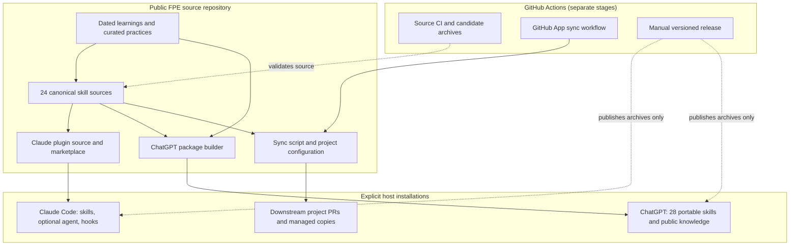

# Product Passport | fpe-agentic-workflow

This repository is the source and distribution layer for Claude Code and ChatGPT Agentic Workflow. Claude Code has user setup, agents and downstream sync; the ChatGPT edition is a generated skills-only package with independent installation and host capabilities. It is not a universal orchestrator or a hosted service. Product maps are navigation aids; implementation and observed behavior take precedence.

**Map evidence:** capability routes and source paths are checked by the Product Passport validator; the detailed [repository inventory](inventory.md) records the current manifests and tracked source counts. Tests and host acceptance must be recorded separately for the exact revision.

The source-linked [capability index](index.json) is checked by `node scripts/check-product-passport.mjs`. This verifies path and test references only; it cannot establish actual user behavior. The [DUNE engineering contract](../dune.md) describes paved paths and evidence reconciliation without replacing source or this map.

## Product surfaces and journeys

| User journey | Entry point and owning implementation | Intended outcome | Verification route |
| --- | --- | --- | --- |
| Install personal skills, agents and pinned plugins | `setup-user.sh`, `user/plugins.txt`, `.claude-plugin/marketplace.json` | User-scope install on a laptop or cloud environment | Isolated install and plugin list; **not run for this map** |
| Package the full portable ChatGPT edition (24 shared + 4 portable skills) | `scripts/package_agentic_workflow_chatgpt.py`, `portable/agentic-workflow/plugin.json`, canonical source in `plugins/agent-workflow/skills/` | Deterministic 28-skill ZIP with curated public practices and provenance metadata | `test/test_agentic_workflow_chatgpt.py`, package/manifest checks and artifact integrity; private installation and real routing require independent host proof |
| Sync shared capabilities into a project | `sync-to-repos.sh`, `lib/apply.mjs`, `project/settings.json` | Reviewable downstream PR with managed skills, settings and filtered knowledge | `DRY_RUN=1 bash sync-to-repos.sh` against a disposable project; **not run for this map** |
| Inspect copy drift | `scripts/check-sync.mjs`, `lib/sync-status.mjs` | Detect out-of-date or modified managed copies | `node scripts/check-sync.mjs <project-dir> --json`; **not run for this map** |
| Capture and promote practices | `learnings/`, `kb/practices/`, `scripts/build-kb.mjs`, `plugins/agent-workflow/skills/learning-loop/` | Move evidence into on-demand reusable guidance | `node --test`; **not run for this map** |
| Map features and verify products | `plugins/agent-workflow/skills/product-passport/` | Source-grounded feature ownership, journeys, verification and map upkeep | Test a substantive task in a real target repository; **not run** |
| Audit structural causes and ownership drift | `plugins/agent-workflow/skills/architecture-gardener/` | Read-only structural findings and scoped repairs | Inspect source and negative paths; no host evaluation claimed |
| Execute authorized multi-step repository work | `plugins/agent-workflow/skills/delivery-loop/` | Code-first implementation, CI recovery and final-head verification | Plugin source CI; authenticated behavior not yet verified |
| Frame, propose, evaluate and escalate review proportionately | `plugins/agent-workflow/skills/delivery-loop/SKILL.md`, `plugins/agent-workflow/skills/model-delegation/SKILL.md`, `plugins/agent-workflow/skills/model-delegation/references/risk-gated-review.md` | Source/evaluation fixtures cover routine, high-risk and conflicting-review cases; actual model comparisons and independent judge execution are **not verified** |
| Preserve PR evidence and handovers | `plugins/agent-workflow/skills/session-continuity/`, `user/rules/pr-progress.md` | Durable checklists and context recovery | Source CI; real host routing not yet verified |
| Visual QA and other working practices | `plugins/agent-workflow/skills/` | Select specialized workflows only when task-relevant | Task-level evaluation; **not run** |
| Cross-host review companion | `portable/ogfrench-workflow/` | Optional skill-only review workflows | Per-host acceptance; see source release record |

## Architecture and responsibility boundaries

The arrows represent **source and packaging relationships**, not automatic installation or network access. See the [complete, path-linked inventory](inventory.md) for all skills, plugins, scripts, integrations, bot controls and evidence boundaries.

## Maintained product-map contract

When code or task journeys change, read affected implementation and tests first, then update this map in the same PR. For each downstream product, maintain `docs/product-passport/README.md` (or its established canonical equivalent) and optional `features/<stable-id>.md` entries. A repository-level Claude rule must require map impact assessment even when Product Passport is not selected. Detailed format: [feature contract](../../plugins/agent-workflow/skills/product-passport/references/feature-contract.md).

A change with no capability or ownership impact does not need artificial Markdown churn; explicitly report `map unchanged`. If a capability is only described by documentation, label it `documentation-derived, not source-verified`. Record real tests and user journeys separately with revision and environment, never infer passes from paths.
